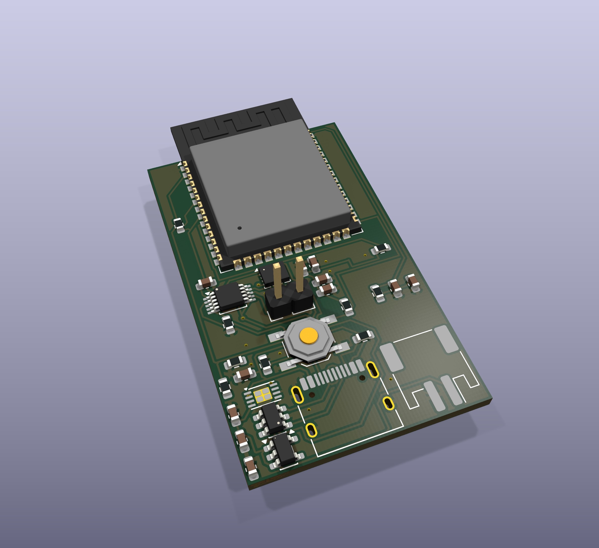

# AlarmShock

As a chronic deep sleeper, I created AlarmShock to help me wake up on time when standard alarms don't work. The design uses a BMI160 accelerometer and gyroscope to measure wrist movement, an ESP32-S3 MCU, and a DRV2605L driver for a vibration motor. The goal is a wrist-worn alarm that combines motion sensing with a physical wake-up signal.

This repository contains the PCB design and its supplied fabrication exports. Firmware, Dashboard, and assembled-device test results are not included. Motion-based control and wake-up performance are not verified by the files in this repository.



*3D render of the saved PCB, not a hardware photograph. Some component body models are absent.*

## Hardware

| Part | Role in this revision |
| --- | --- |
| ESP32-S3-WROOM-1 | Controller; connected to the motion sensor and haptic driver over I2C |
| BMI160 | Accelerometer and gyroscope for wrist-motion sensing |
| DRV2605L | Haptic driver connected to the external motor header, M1 |
| MCP73831 | Battery charging circuit |
| XC6220B331MR | 3.3 V regulator |
| USB-C and USBLC6-2SC6 | USB connection and data-line ESD protection |

The motion sensor measures acceleration and angular rate; this revision has no heart-rate sensor. It has not been validated for sleep-stage detection. Component references: [Bosch BMI160 datasheet](https://www.bosch-sensortec.com/media/boschsensortec/downloads/datasheets/bst-bmi160-ds000.pdf) and [TI DRV2605L](https://www.ti.com/product/DRV2605L).

## Open the board

Use KiCad 10 and open `KiCad/Alarmshock_protofinal.kicad_pro`, then launch the PCB editor. Standard KiCad footprint libraries are required. No schematic was present in the supplied project, so this archive contains the board and its pad/net assignments rather than a complete schematic project.

To repeat the board check:

```sh
kicad-cli pcb drc --output DRC-review.rpt KiCad/Alarmshock_protofinal.kicad_pcb
```

## Current status

A fresh KiCad 10.0.5 check reports 3 warnings and 0 unconnected items. Two warnings concern silkscreen at the board edge; the third is an ESP32-S3 footprint/library mismatch. The report lists the configured ignored checks. See [DRC-current.rpt](KiCad/DRC-current.rpt); the supplied older report is preserved as `DRC-original.rpt`.

The assembly files need reconciliation before ordering: `UPLOAD_BOM_no_M1_no_U3.csv` and its CPL omit the motor and BMI160, and the board's R4 value is `e` while the assembly BOM lists 4.7 kOhm. These files are preserved as supplied. Gerbers are existing exports, not a fabrication approval. Battery charging, assembled operation, haptic output and wake-up reliability have not been verified in this review.

## Files

- `KiCad/`: editable board, project settings, component list and DRC reports.
- `gerbers/`: supplied copper, mask, paste, silkscreen, outline and drill exports.
- `previews/`: a 3D JPG exported from the unchanged board.
- `UPLOAD_BOM_no_M1_no_U3.csv` and `UPLOAD_CPL_no_M1_no_U3.csv`: supplied partial assembly files.
- `SHA256SUMS.txt`: checksums for the repository files.

The supplied folder had no development Git history to import. Original project files remain unchanged. Personal concept notes and local KiCad preferences are excluded. No license has been added.
